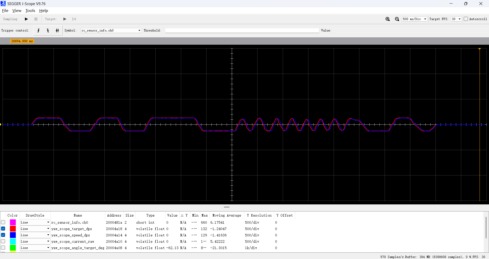
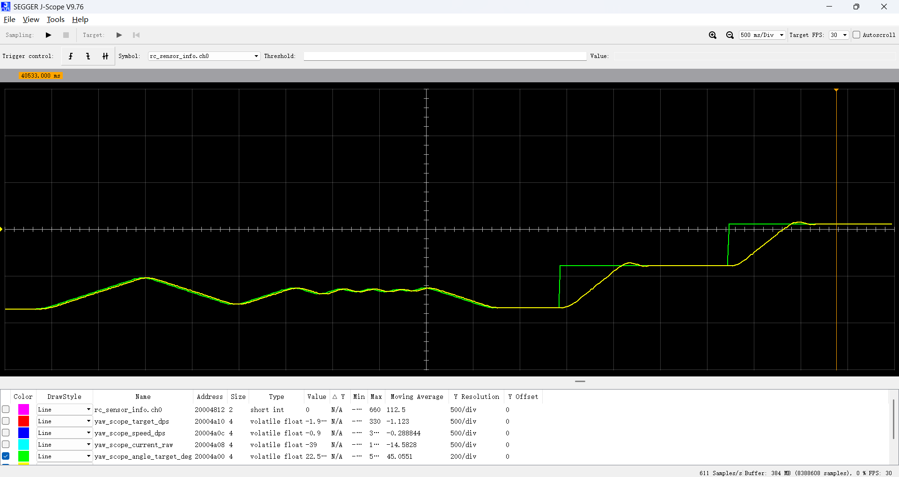
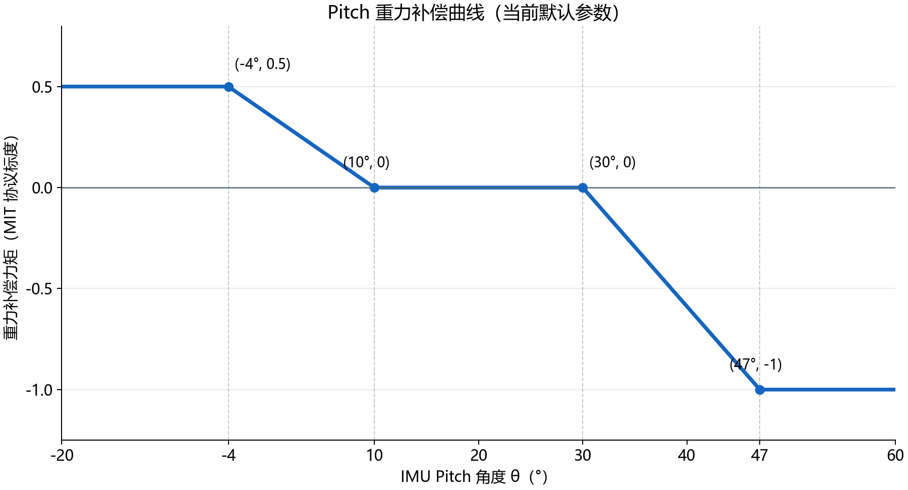

# 说明(修改中)

该文档为部分细节说明

## 陀螺仪GYRO模式下的底盘跟踪云台说明

底盘和云台的主要衔接是来自编码器的角度差

通过读取电机编码器两次角度的差值（还需经过归一化[−180°，180°)处理），作为跟踪函数的输入值x

            v = a × x + b × x²
            （具体函数：|v| = a × (4096 / 180) × |θ| + (F90 − a × 2048) × (|θ| / 90)²）

其中a为一次项系数，现实变现为小角度的跟踪力度，b为二次项系数，现实表现为大角度的跟踪力度，这里采用“一圈8192格”的刻度体系，因此a需乘以 (4096 /180)，当角度差达到90度时（180°折叠角度），函数输出最大。最后v作为轮子的旋转混合量，单位RPM

数据流动结构如下

    云台相对底盘角度 θ，单位：度
    ↓ Gyro_Follow()
    底盘旋转混合量 rotate，单位：转子RPM
    ↓ Chassis_Mix(front, right, rotate)
    四个轮子的目标转速，统一限幅
    ↓ RM_Motor_SpeedControl()
    轮速目标斜坡 → 与实际转速比较 → 速度PI
    ↓
    四个轮子的电流指令，原始CAN值
    ↓ CAN_Send()内部调用Motor_PackCurrent()
    CAN发送给电调 → 驱动电机

## 底盘解算简易说明

目前底盘轮子使用PI速度环控制

    左前目标 =  前进 + 右移 + 旋转;
    左后目标 =  前进 - 右移 + 旋转;
    右前目标 = -前进 + 右移 + 旋转;
    右后目标 = -前进 - 右移 + 旋转;

各个目标值在进入PI控制前会会进行统一限制（包含目标角度和加速度限制）。

    目标角度超出部分按比例统一缩小，保证运行模型不变
    本周期允许变化量 = acceleration_rpm_per_second × dt
    斜坡后目标 += 限幅( 原始轮速目标 − 斜坡后目标, ±本周期允许变化量)
## 机械模式，陀螺仪模式，小陀螺模式下的yaw控制说明

机械模式下，反馈值来自编码器刻度。陀螺仪和小陀螺模式下，反馈值来自陀螺仪角度

机械模式下的双环PID参数见 [机械PID参数](Application\ConfigLayer\gimbal_config.h);
效果图：
    
    

    
陀螺仪和小陀螺模式下双环PID参数见 [陀螺仪与小陀螺PID参数](Application\ConfigLayer\gyro_config.h);
效果图：
    
    

## 云台pitch说明

云台的反馈值来自IMU（不建议用电机编码器刻度作为反馈值）

双环PID参数在上版的 Application\ConfigLayer\pitch_config.h 目录下
除了PID控制外还有重力补偿，补偿机制如图
    

## 操作说明

| 操作 | 功能 |
|------|------|
| 两拨杆都下档 | 键鼠控制，其余组合为遥控控制 |
| 双下档，拨轮正端到底→回中 | 机械／陀螺仪模式往返切换 |
| 键鼠按一下 V | 机械／陀螺仪模式往返切换 |
| 双上档，拨轮负端到底→回中；或键鼠 R | 云台转 180° |
| 左上右中，拨轮负端到底→回中 | 小陀螺进入／退出 |
| 键鼠按住／松开 F | 小陀螺进入／退出 |
| 双中档，拨轮负端到底→回中 | 开关发射系统，开启时初始化拨弹 |
| 发射开启后右拨杆上档 | 持续请求发射，最短间隔 600ms |
| 键鼠左键／B／Q | 首次开启、后续单发／关闭发射／重新初始化 |

